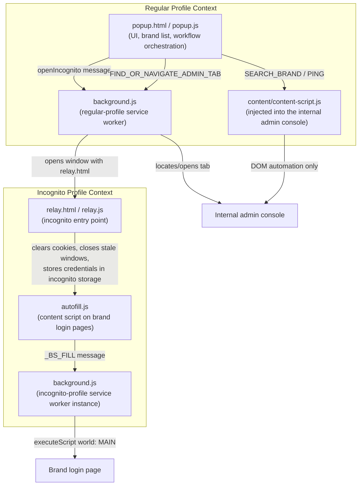

# Brandstorm Architecture

This document covers the full technical design: motivation, the split-incognito constraint, the complete request/message flow, design tradeoffs, security considerations, and lessons learned. See [README.md](README.md) for the high-level overview.

---

## Motivation

Manual credential handling for dozens of active brand environments creates two compounding problems:

1. **Toil**: the same nine-step process (find brand, open incognito, navigate admin console, click reset, confirm dialog, read new password, copy it, open brand login, paste and submit) repeated many times a day.
2. **Risk**: manual steps are exactly where mistakes happen: forgetting to use a clean/incognito session and inheriting another account's cookies, miscopying a password, or leaving a stale session logged in on a shared machine.

Brandstorm was designed to remove both. Automating the *mechanical* parts of the workflow (navigation, clicking, typing, copying) reduces the time cost to a single click while making the *safety* properties (a guaranteed-clean session, a password that's never manually retyped) the default behavior, rather than something the user has to remember to do correctly every time.

---

## Architecture

Brandstorm's architecture is shaped almost entirely by one Manifest V3 constraint: **`"incognito": "split"`**. In split mode, an extension gets two completely separate runtime contexts (a regular-profile instance and an incognito-profile instance) with their own `chrome.storage.local`, and the regular-profile background cannot directly script pages running inside incognito. Every non-obvious piece of this extension exists to work around that isolation correctly and safely.



**Core components:**

| Component | Runs in | Responsibility |
|---|---|---|
| `popup.html` / `popup.js` / `popup.css` | Regular profile, extension popup | UI, search/filter, all workflow orchestration and the shared modal state machine |
| `background.js` | Both profiles (one instance each, isolated) | Regular instance: opens incognito windows, finds/creates the admin tab. Incognito instance: performs `MAIN`-world script injection to fill login forms |
| `relay.html` / `relay.js` | Incognito profile only | Entry point for every incognito window: closes stray incognito windows, wipes cookies, stores one-time-use autofill credentials, then navigates to the target brand |
| `autofill.js` | Incognito profile, content script | Declaratively injected into brand login pages, reads the one-time credentials from incognito storage and hands off to the incognito background for the actual fill |
| `content/content-script.js` | Regular profile, injected only into the internal admin console origin | Origin-guarded DOM automation: brand search, password-reset triggering, one-time-link dispatch |
| `brands.js` | Both, loaded by the popup | Static registry of known brand entries (curated list + an auto-generated set), merged with user-added custom entries at render time |

---

## Workflow: "Take me there" (full automation)

1. User clicks **Take me there** on a brand card in the popup.
2. `popup.js` asks `background.js` to find or open a tab on the internal admin console.
3. The admin content script waits for the console's brand grid to finish loading, uses its search field to locate the target brand, and reads back its internal ID from the rendered card.
4. The popup navigates that tab directly to the brand's detail route (via the console's own client-side router where available, falling back to a hash change).
5. A two-step click sequence triggers the console's password-reset button, waits for its confirmation dialog to mount, and clicks confirm, using a Vue-internal event dispatch where a plain DOM click wouldn't register.
6. The popup polls the console's DOM for the newly generated password, which the console itself displays as a notification or dialog value after the reset call succeeds.
7. The password is copied to the clipboard, and the popup asks `background.js` to open a fresh incognito window with the credentials `base64`-encoded into the relay URL.
8. `relay.js` (now running inside incognito) closes any other incognito windows, wipes cookies for the target domain, decodes the credentials into incognito's own `chrome.storage.local` with a short expiry, and navigates to the brand's login page.
9. `autofill.js` reads those one-time credentials, deletes them immediately, and delegates the actual form fill to the incognito background, which injects a `MAIN`-world script so the page's own framework recognizes the programmatic input.
10. The login form is submitted automatically. Total user interaction: one click and one confirmation.

## Example Workflow: "Reset for a colleague"

> Support engineer needs to give a teammate temporary access to a specific brand.

1. Open the popup, type part of the brand's name into the search box.
2. Click **Reset for…** on the matching brand card, enter the teammate's email, confirm.
3. Brandstorm opens the admin console in a background tab, locates the brand, triggers its "send one-time reset link" dialog, fills in the recipient's email, and confirms, without pulling the popup away from the engineer's foreground work.
4. The modal reports success: a self-expiring, view-limited reset link has been emailed directly by the internal console, and the action is recorded in that console's own audit log.

---

## Design Decisions

**Split incognito over "spanning" incognito.** Spanning mode is simpler (one shared background, one shared storage) but doesn't give the strong guarantee this tool needs: a completely fresh, cookie-free session every time. Split mode's cost (two isolated runtime contexts that can't talk to each other directly) was accepted deliberately in exchange for that guarantee, and the `relay.html` pattern was built specifically to bridge it safely.

**DOM automation instead of calling internal endpoints directly.** The extension never issues its own authenticated request to the password-reset endpoint. Instead, it clicks the real button in the real admin console, in a real logged-in tab, and lets that application's own session, CSRF handling, and audit logging do their job untouched. This keeps the extension from ever needing to hold, mint, or manage its own credentials or tokens against the internal API. It only ever acts as a (very fast) stand-in for a human clicking buttons.

**A shared modal state machine across three different flows.** "Reset Pass," "Take me there," and "Reset for a colleague" all funnel through the same six-state modal (`loading → confirm → executing → done → server-error → error`), with each flow supplying its own copy and confirm-callback. This avoided three near-duplicate UIs and made adding the third flow (send-to-colleague) mostly a matter of wiring, not rebuilding.

**Content script deliberately kept "dumb" about the password value.** The script that clicks the reset button in the admin console does not read, store, or log the password the console displays afterward. That capture step lives entirely in the popup's own polling logic, and only runs for flows that explicitly need the value (to autofill or clipboard it). Keeping the click-trigger script blind to the secret by default reduces the surface area that ever touches it.

**Built-in brand list + auto-generated list + user-added custom entries, merged at render time**, rather than a single hardcoded array. This keeps the tool useful without needing a code change every time a new brand is provisioned, while still letting the extension ship with a ready-to-use baseline.

---

## Security Considerations

- **No third-party network calls anywhere in the codebase.** Every action either manipulates the local browser (windows, cookies, storage) or scripts a page already reachable under the extension's own `host_permissions`. There is nothing to intercept in transit because nothing leaves the browser to an external service.
- **`host_permissions` scoped to a single internal domain.** The extension cannot script or read cookies for any site outside that domain.
- **Origin-guarded automation.** The script that interacts with the internal admin console checks `window.location.origin` against an expected value before doing anything and throws immediately on mismatch, so it cannot be tricked into running its logic against an unexpected page.
- **Credentials are transient and single-use.** When the full-automation flow needs to carry a password from the reset step into the login-fill step, it's written to storage with a short expiry, read exactly once, and deleted immediately after. It is never persisted beyond that handoff, aside from the clipboard, which is the intended hand-off point to the user.
- **Guaranteed session isolation before every automated login.** Closing stale incognito windows and wiping cookies before navigating means an automated login can never accidentally reuse another session's state.
- **A known, accepted limitation:** deleting a brand entry from the popup is gated behind a simple local PIN prompt. This is a UX safety rail against accidental clicks, not a real access control. It's client-side, easily bypassed by inspecting the extension, and was never intended to guard anything more sensitive than "don't delete this list entry by mistake." It's called out here deliberately rather than left implicit, since a security-conscious reviewer should be able to tell "convenience guard" apart from "security boundary" at a glance.

---

## Challenges Solved

Getting reliable, framework-safe DOM automation working inside the constraints of split-incognito mode took several failed approaches before landing on a working one:

- **Storage isolation between regular and incognito profiles** meant credentials written by the popup were never visible to a content script running in incognito. Solved by having the *incognito-side* relay page write to storage itself, so both ends of the handoff share the same storage instance.
- **Framework reactivity ignoring plain DOM writes.** Setting `input.value` directly doesn't notify Vue's reactivity, since content scripts run in an isolated JS world with their own prototype chain. Fixed by injecting the fill logic into the page's own `MAIN` world and writing through its *native* `HTMLInputElement` prototype setter, with `input`/`change` events dispatched afterward.
- **`window.name`, a tempting cross-navigation relay channel, is deliberately cleared by Chrome** when navigating from an extension page to a normal page. This is a privacy protection that silently defeated an earlier design before the incognito-storage approach replaced it.
- **Hidden decoy form fields** on the target login page matched naive input selectors before the real, visible fields did. Solved by filtering every candidate element through an `offsetParent !== null` visibility check.
- **Timing against a single-page application** that doesn't render synchronously. Solved throughout with `MutationObserver`-driven waits (with hard timeouts as a backstop) instead of fixed `setTimeout` delays, so the automation adapts to slow renders rather than racing them.
- **Silent failure from a scoping typo** (a message-listener parameter renamed but not updated at its call site) that made an entire flow no-op with no visible error. A reminder that DOM automation of this kind benefits from explicit error codes and a mapped, user-facing message for every failure path, which the current modal system now provides.

---

## Future Improvements

- **Automated tests around the DOM-selector layer.** The admin-console selectors are the most fragile part of the system (they already required a full pass of updates after a UI refresh on that console). A small harness that snapshots expected DOM shapes would catch breakage before a live workflow does.
- **Structured logging/telemetry for failure modes**, so that when a selector-based step fails in the field, there's more to go on than the mapped error code alone.
- **Optional secrets-manager integration** for teams that want reset passwords handed off through a vault rather than the clipboard.
- **Cross-browser support.** The extension currently assumes Chromium-specific incognito/split-mode semantics; a Firefox-compatible variant would need its own investigation into that browser's equivalent isolation model.

---

## Lessons Learned

- **Browser platform privacy features will actively work against naive automation.** `window.name` clearing on cross-origin navigation is a good example of a mechanism built to protect users that also quietly breaks a plausible-looking data-relay design. Understanding *why* a browser API is scoped the way it is saves time versus debugging around a symptom.
- **Framework reactivity is a first-class constraint for browser automation, not an edge case.** Any tool that programmatically fills a modern SPA's form needs to think in terms of "how does this framework observe state changes," not just "how do I set a DOM property."
- **Isolated JS worlds are the default for a reason**, but that same isolation is exactly what breaks framework-compatible form filling. The fix, deliberately stepping into the page's `MAIN` world only for the one operation that needs it, is a good example of using the least-privileged mechanism available rather than reaching for broader access than the task needs.
- **A shared, explicit state machine for multi-step async UI flows pays for itself quickly.** Once the reset modal existed as a small set of named states, adding a third distinct workflow onto it was significantly cheaper than the first two had been individually.
- **Silent failures are the most expensive kind.** The scoping typo that quietly no-op'd an entire flow only surfaced through manual console logging; the current codebase's discipline around explicit `{ ok, error }` return shapes and mapped user-facing error messages was a direct response to that experience.

---

## Full Code Structure

```
.
├── manifest.json                # MV3 manifest: permissions, content scripts, split incognito
├── popup.html                   # Popup markup: brand list, search, modal overlay
├── popup.css                    # Dark-theme styling for popup + modal
├── popup.js                     # All popup logic: rendering, search, reset/full-auto/reset-for flows
├── background.js                # Regular + incognito service worker: window/tab management, MAIN-world injection
├── relay.html / relay.js        # Incognito entry point: session cleanup + credential handoff
├── autofill.js                  # Content script on brand login pages: reads handoff credentials
├── content/content-script.js    # Content script on the internal admin console: search + reset automation
├── brands.js                    # Brand registry (curated + auto-generated), merged with user custom entries
├── icons/                       # Extension icons
└── DEVLOG.md                    # Internal development log covering design iterations in detail
```

Each file maps to exactly one runtime context and one responsibility. There is no shared "utils" grab bag, which keeps it easy to reason about which profile (regular vs. incognito) any given piece of code is actually running in.
