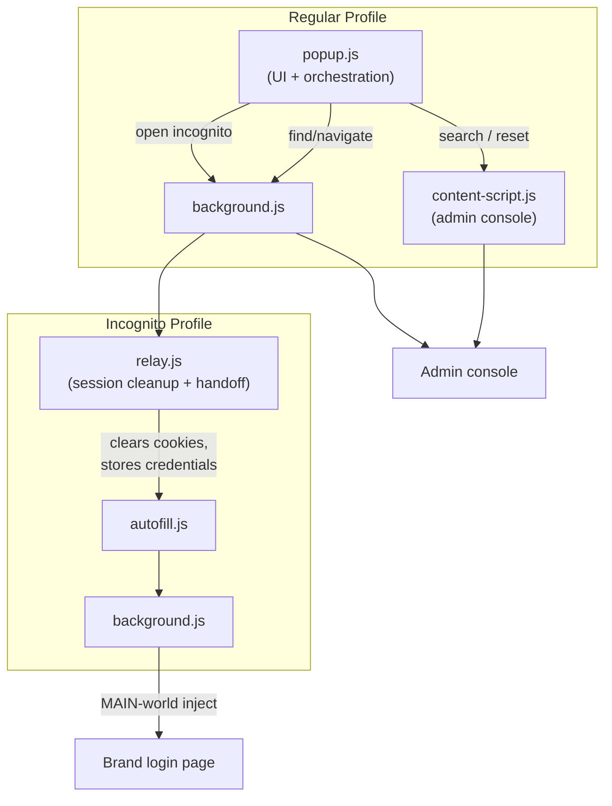

# Brandstorm

[](https://github.com/henperets/brandstorm-support-automation/actions/workflows/ci.yml)

**A Manifest V3 Chrome extension that automates repetitive internal support workflows, including clean-session brand access, credential rotation, and secure one-time credential sharing, with zero backend, zero build step, and zero third-party dependencies.**

> Built by Hen Perets as an internal productivity tool, and shared here as a portfolio piece demonstrating browser-extension architecture, browser-automation engineering, and pragmatic security design.

**[Architecture deep-dive →](ARCHITECTURE.md)** &nbsp;·&nbsp; **[Development log →](DEVLOG.md)**

> **Note on this repo:** Brandstorm was built for, and only works against, my employer's real internal admin console and brand infrastructure, so it isn't a general-purpose tool. All domains, the brand/customer list, and other employer-identifying details in this repo have been replaced with fictional placeholder data (see `nimbus.example` throughout the code). It's shared here to demonstrate the engineering, not as something you can clone and run. The demo video below shows it working against the real environment.

---

## 🎬 Demo

https://github.com/user-attachments/assets/2bfe7f57-ead9-4482-bf2a-393b0960e1ba

*"Take me there": one click resets the password, opens a clean incognito window, autofills the login form and signs in.*

---

## Impact

- Collapsed a ~9-step manual credential-reset process into a single click
- Used daily for internal support workflows across dozens of brand environments
- Eliminated session-bleed risk by enforcing a guaranteed-clean incognito session before every login
- Fully client-side: no backend, no database, no third-party network calls
- Built with Manifest V3 and vanilla JavaScript: no framework, no bundler, no dependencies

---

## Overview

Brandstorm targets a SaaS company that hosts many customer-specific "brand" instances of its product. Support work involved repeatedly finding a brand's login URL, opening it in a clean session, resetting a user password through an internal admin console, and logging in, sometimes on behalf of a teammate. Brandstorm turns that sequence into single clicks, driving the browser itself (windows, cookies, DOM) rather than calling any API directly.

## Features

- **Brand launcher & search**: a searchable, filterable list of every known brand environment
- **Copy URL**: one click to copy a brand's login URL
- **Open in clean incognito session**: closes stale incognito windows and wipes cookies before opening the brand URL, guaranteeing no session bleed-through
- **Reset User Password**: drives the admin console's own reset control, reads the new password back out of the UI, and copies it. The extension never calls the reset endpoint itself
- **"Take me there" (full automation)**: reset, capture password, open a fresh incognito window, autofill the login form, and submit, all unattended
- **Reset password for a colleague**: drives the admin console's built-in one-time-link feature to email a self-expiring, audit-logged reset link (no third-party link service)
- **Open brand logs**: jumps to a brand's log page and its Kibana dashboard
- **Custom brand management**: add or remove ad-hoc brand entries, stored locally

## Architecture (high level)

The whole design is shaped by one MV3 constraint: **`"incognito": "split"`**, which gives the extension two fully isolated runtime contexts (regular and incognito) that can't script each other directly or share storage. A `relay.html` page running *inside* incognito bridges that gap safely.



Full component breakdown, message flow, and design rationale live in **[ARCHITECTURE.md](ARCHITECTURE.md)**.

## Notable Engineering Challenges

- **Storage isolation between profiles**: regular and incognito each have their own `chrome.storage.local`. Fixed by having the *incognito-side* relay page write the handoff data itself, so both ends share the same storage instance.
- **SPA framework reactivity ignoring plain DOM writes**: setting `input.value` from an isolated content-script world doesn't notify Vue. Fixed by injecting into the page's `MAIN` world and writing through its native prototype setter.
- **`window.name` silently cleared by Chrome** on cross-origin navigation from an extension page. It defeated an earlier credential-relay design before the incognito-storage approach replaced it.
- **Hidden decoy form fields** matched naive selectors before the real ones. Fixed with an `offsetParent !== null` visibility check.

More detail, plus how a silent scoping-typo bug shaped the current error-handling model, is in [ARCHITECTURE.md](ARCHITECTURE.md).

## Technologies

- **Manifest V3**: service-worker background, declarative + programmatic content scripts, `scripting` API for `MAIN`-world execution
- **Vanilla JavaScript, HTML, CSS**: no framework, no bundler, no `npm` dependencies
- **Chrome Extension APIs**: `windows`, `tabs`, `cookies`, `storage.local`, `scripting`, `runtime` messaging
- **DOM automation against a Vue 3 + Quasar SPA**, including reverse-engineering its reactivity
- **MutationObserver-based waits** in place of fixed timeouts

## Security Summary

- No third-party network calls anywhere: every action stays inside the browser or scripts a page already covered by `host_permissions`
- `host_permissions` scoped to a single internal domain
- Admin-console automation is origin-guarded and throws on any mismatch
- Handoff credentials are short-lived, single-use, and deleted immediately after read
- Every automated login is preceded by a guaranteed session wipe

Full write-up, including one deliberately-accepted, clearly-labeled limitation, is in [ARCHITECTURE.md](ARCHITECTURE.md#security-considerations).

## Code Structure

```
.
├── manifest.json                # MV3 manifest: permissions, content scripts, split incognito
├── popup.html / popup.js / popup.css   # UI, search, and workflow orchestration
├── background.js                # Regular + incognito service worker
├── relay.html / relay.js        # Incognito entry point: session cleanup + credential handoff
├── autofill.js                  # Content script on brand login pages
├── content/content-script.js    # Content script on the internal admin console
├── brands.js                    # Brand registry (curated + auto-generated + custom entries)
├── icons/                       # Extension icons
├── .github/workflows/ci.yml     # CI: JS syntax check + manifest validation
├── ARCHITECTURE.md              # Full technical deep-dive
└── DEVLOG.md                    # Internal development log
```

---

For the full architecture, workflow trace, design decisions, security considerations, and lessons learned, see **[ARCHITECTURE.md](ARCHITECTURE.md)**.

---

## Copyright & Usage Notice

Copyright © 2026 Hen Perets. All rights reserved.

This repository is a read-only portfolio piece. It documents an internal tool built for my employer's systems and is shared only to demonstrate engineering concepts and design decisions. It is not open source, and no license is granted to use, copy, modify, distribute, or build upon this code or documentation, in whole or in part, without prior written permission.

All company names, domains, and customer data in this repository are fictional placeholders. Any resemblance to real organizations is coincidental. Viewing the code and cloning it for personal reading is welcome. For any other use, please get in touch first.
